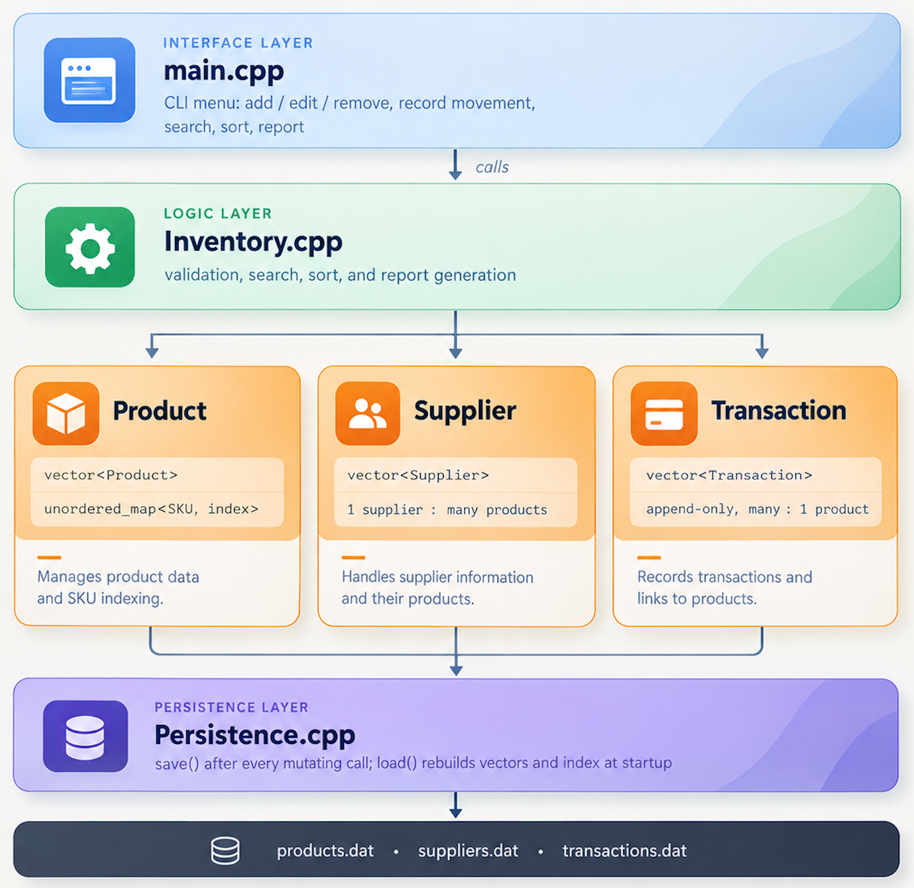

# Smart Inventory Management System

C/C++ course project, Task 3 (DLBMINPAPCC01_E, IU Internationale Hochschule).
Author: Masabo Frank,
Matriculation No. 321147823.

Repository: [GitHub repository is here](https://github.com/frankkode/InventoryApp)

## Status

This project is being built incrementally, one reviewed commit at a time.
The data model and architecture below reflect the design from the Phase 1
conceptual document; the code that implements it lands layer by layer, see
the commit history for progress. This README will keep growing (test
instructions, scope, screenshots) as each layer lands.

### Implementation progress

- [x] Project scaffold (CMake, compiling skeleton)
- [x] Data layer (`Product`, `Supplier`, `Transaction`)
- [x] Persistence layer
- [x] Logic layer (`Inventory`)
- [x] CLI
- [ ] Tests
- [ ] Optional GUI with product photos
- [ ] ER diagram, codebook, screenshots

## Data model

Three domain classes cover the required scope. `Product` holds a SKU, name,
category, unit price, quantity on hand, reorder threshold, and a supplier
reference. `Supplier` holds an ID, name, and contact details. `Transaction`
holds an ID, timestamp, the affected product's SKU, a type (stock-in,
stock-out, or adjustment), a quantity delta, and a note.

A `Supplier` can supply many `Product`s, and every `Transaction` updates
exactly one `Product`'s quantity. `Inventory` owns the lifetime of every
`Product`, `Supplier`, and `Transaction` it holds, storing each by value in
its own `std::vector`. Cross-entity references (`Product::supplierId`,
`Transaction::productSku`) are deliberately plain string IDs rather than
pointers or iterators, so they stay valid even when the underlying vector
reallocates during growth.


*Figure 1. UML class diagram: class attributes, key operations, composition
relationships, associations with multiplicities, and the `TransactionType`
enumeration. Source: own illustration.*

## Architecture

The system follows a three-layer design. The interface layer (`main.cpp`)
is a CLI menu for add/edit/remove, recording stock movements, search, sort,
and reporting. The logic layer (`Inventory.cpp`) validates every input and
performs search, sort, and report generation. The persistence layer
(`Persistence.cpp`) owns all file I/O, saving after every mutating call and
rebuilding the in-memory vectors and SKU index on load.



*Figure 2. Layered architecture, entity storage, and persistence flow.
Source: own illustration.*

## Build and run

```bash
mkdir -p build && cd build
cmake ..
cmake --build .
./inventory
```

`inventory` is an interactive text menu. It reads `products.dat`,
`suppliers.dat`, and `transactions.dat` from whichever directory you run it
from (so from `build/`, those files appear there), creating them on first
use.
