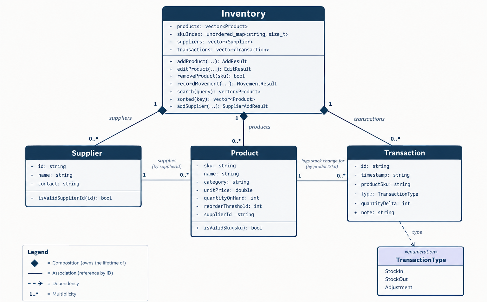

# Smart Inventory Management System

C/C++ course project, Task 3 (DLBMINPAPCC01_E, IU Internationale Hochschule).
Author: Masabo Frank,
Matriculation No. 321147823.

Repository: [GitHub repository is here](https://github.com/frankkode/InventoryApp)

## Status

This project is being built incrementally, one reviewed commit at a time.
The data model and architecture below reflect the design from the Phase 1
conceptual document; the code that implements it lands layer by layer, see
the commit history for progress.

### Implementation progress

- [x] Project scaffold (CMake, compiling skeleton)
- [x] Data layer (`Product`, `Supplier`, `Transaction`)
- [x] Persistence layer
- [x] Logic layer (`Inventory`)
- [x] CLI
- [x] Tests
- [x] Optional GUI with product photos
- [ ] ER diagram, codebook, screenshots

## Data model

Three domain classes cover the required scope. `Product` holds a SKU, name,
category, unit price, quantity on hand, reorder threshold, a supplier
reference, and an optional image path used by the GUI. `Supplier` holds an
ID, name, and contact details. `Transaction` holds an ID, timestamp, the
affected product's SKU, a type (stock-in, stock-out, or adjustment), a
quantity delta, and a note.

A `Supplier` can supply many `Product`s, and every `Transaction` updates
exactly one `Product`'s quantity. `Inventory` owns the lifetime of every
`Product`, `Supplier`, and `Transaction` it holds, storing each by value in
its own `std::vector`. Cross-entity references (`Product::supplierId`,
`Transaction::productSku`) are deliberately plain string IDs rather than
pointers or iterators, so they stay valid even when the underlying vector
reallocates during growth.



*Figure 1. UML class diagram: class attributes, key operations, composition
relationships, associations with multiplicities, and the `TransactionType`
enumeration. Source: own illustration.*

## Architecture

The system follows a three-layer design. The interface layer (`main.cpp`,
plus the optional `src/gui/GuiMain.cpp`) is a CLI menu, and now also a
desktop GUI, for add/edit/remove, recording stock movements, search, sort,
and reporting. The logic layer (`Inventory.cpp`) validates every input and
performs search, sort, and report generation. The persistence layer
(`Persistence.cpp`) owns all file I/O, saving after every mutating call and
rebuilding the in-memory vectors and SKU index on load. Both interfaces
call through the same `Inventory` and read/write the same three data
files, so they are interchangeable on one inventory folder.


*Figure 2. Layered architecture, entity storage, and persistence flow.
Source: own illustration.*

## Build and run

```bash
mkdir -p build && cd build
cmake ..
cmake --build .
./inventory
```

`inventory` is an interactive text menu. It reads `products.dat`,
`suppliers.dat`, and `transactions.dat` from whichever directory you run it
from (so from `build/`, those files appear there), creating them on first
use.

## Tests

```bash
cd build
./inventory_tests
```

or, via CTest:

```bash
cd build
ctest --output-on-failure
```

`inventory_tests` is a plain-assertion suite (no external framework)
covering input validation, duplicate/unknown-SKU and unknown-supplier
rejection, stock movements (including the guard against a stock-out
dropping quantity below zero), search, sort, and a save/reload persistence
round trip that exercises the comma/quote escaping described above.

## Optional GUI

```bash
cd build
./inventory_gui
```

`inventory_gui` is a Dear ImGui + GLFW + OpenGL3 desktop window built on
the exact same `Inventory`/`Persistence` core as the CLI, so it reads and
writes the same data files and either interface can be used on the same
folder. Tabs mirror the CLI menu:

- **Products**: add a product (with a "Browse..." button that opens the
  OS's native file picker to choose a photo from disk, rather than typing
  a path), edit or remove any existing product, with removal behind a
  confirmation dialog. The table shows a photo thumbnail per row and
  highlights rows at or below their reorder threshold in red.
- **Suppliers**: add or remove a supplier (also behind a confirmation
  dialog); a removal is rejected, with the error shown in the GUI, if any
  product still references that supplier.
- **Stock movement**: record a stock-in, stock-out, or adjustment against
  any product.
- **Transactions**: the full transaction history.

The task requires only a CLI; the GUI is the explicitly allowed optional
extension. It builds automatically alongside `inventory` and
`inventory_tests` (CMake fetches GLFW, Dear ImGui, stb_image, and
tinyfiledialogs the first time, which needs an internet connection and
takes a bit longer than a normal build) and can be turned off with:

```bash
cmake .. -DINVENTORY_BUILD_GUI=OFF
```
